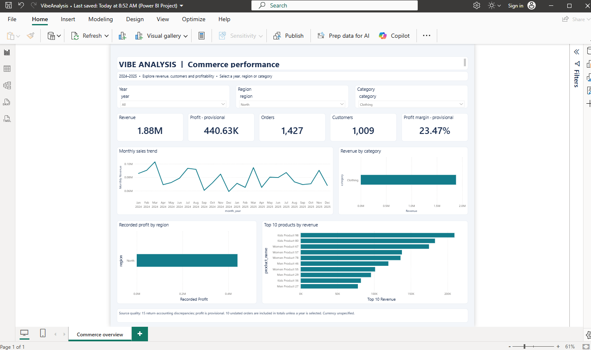
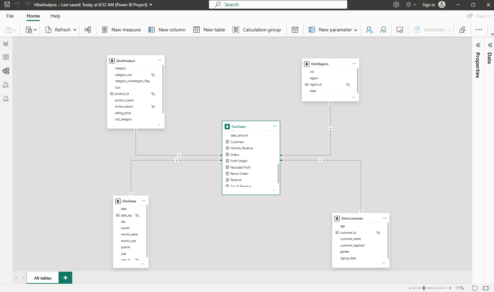

Vibe Analysis — E-Commerce Sales & Profit Dashboard
An end-to-end Power BI portfolio project developed using ChatGPT (GPT-6 Astra), directed by Jitendra More.

Power BI · Power Query · DAX · Star Schema · Data Quality · AI-Assisted Analytics
Data Analyst Portfolio Project | 2026

An e-commerce analytics project that turns four raw CSV files into a cleaned analytical model and an interactive Power BI report. Explore revenue, recorded profit, order volume, purchasing customers, product categories and regional performance using Year, Region and Category slicers.

AI development & project ownership
This project was developed end to end using OpenAI ChatGPT (GPT-6 Astra) through an iterative workflow directed by Jitendra More.

Contributor	Role in this project
ChatGPT (GPT-6 Astra)	Supported the technical implementation across profiling, cleaning logic, analytical tables, Power Query, DAX, semantic model and report-file generation, dashboard configuration, validation, documentation and troubleshooting.
Jitendra More	Supplied the datasets, defined requirements, directed the work through prompts and feedback, followed the local setup steps, shared Power BI results and managed the GitHub upload process.
This is an AI-assisted learning and portfolio project with substantial AI-generated implementation. The documentation records the calculations, cleaning decisions and unresolved issues so the work can be reviewed and explained.

Dashboard preview
Full dashboard — all filters

Power BI Desktop screenshot supplied by Jitendra More. Year, Region and Category are all set to All. KPI cards use rounded display values: 25K orders represents 24,905 orders; exact totals are listed below.

 
View a filtered example — North region and Clothing category
 
This earlier screenshot shows North + Clothing, with all years selected, so its values differ from the unfiltered totals.

The GitHub preview is a static image. Download the repository and open the Power BI project to use the interactive filters. No public Power BI Service report is linked in this repository.

Business questions
How do revenue, recorded profit and orders change by month?
Which categories generate the most revenue?
Which regions contribute the most recorded profit?
Which products are the top revenue contributors?
Which high-revenue products have below-average margins?
Unfiltered KPI snapshot
The packaged validation results record the following unfiltered totals:

KPI	Value
Revenue	29,374,086.19
Recorded profit — provisional	6,732,332.30
Orders	24,905
Purchasing customers	2,000
Recorded profit margin — provisional	22.92%
Dated coverage	January 2024–December 2025
Amounts use the units supplied in the source; currency is unspecified. Revenue includes negative sales from records flagged as returns. Profit and margin remain provisional because 15 return records have unresolved cost/profit sign inconsistencies.

Report features
Five KPI cards: revenue, recorded profit, orders, purchasing customers and profit margin.
Monthly sales trend.
Revenue by product category.
Recorded profit by region.
Dynamic top 10 products by revenue within the selected filters.
Year, Region and Category dropdown slicers connected to all KPI cards and charts.
Analytical model
One fact table is linked to four dimensions through active, single-direction one-to-many relationships.

Table	Rows	Grain / relationship key
FactSales	24,905	One distinct single-product order; order_id
DimCustomer	2,000	One customer; customer_id
DimProduct	100	One product; product_id
DimRegion	20	One geographic member; region_id
DimDate	731	One valid date; date_key

 
View the Power BI star schema
  

Data preparation
Source	Raw rows	Treatment
Customers	2,010	Removed 10 exact duplicate customer records; retained 2,000 unique customer IDs.
Products	100	Standardized category case and spacing; corrected 12 category/subcategory combinations using the documented prevailing mappings; preserved original categories and resolution notes.
Regions	20	Confirmed unique IDs, complete values and consistent labels.
Orders	25,050	Removed 50 exact duplicate copies and 95 orders with missing customer/product IDs; retained 24,905 orders.
Additional preparation:

Preserved 10 invalid order dates as null, with the original date text and quality flag.
Added is_return for the 15 negative-quantity records. This flag is inferred from quantity; the source does not supply an explicit return status.
Built DimDate from unique valid order dates and added date_key to FactSales.
Verified that all populated customer, product, region and date references match their dimensions.
Measure definitions
Measure	Definition
Revenue	Sum of signed sales_amount
Recorded Profit	Sum of supplied profit
Orders	Distinct count of order_id, including returns
Customers	Distinct purchasing customer_id in the fact table under the selected filters
Profit Margin	Recorded Profit ÷ Revenue; ratio of totals
Monthly Revenue	Revenue for valid dated month points
Top 10 Revenue	Revenue for the top ten products within current slicer selections
The editable DAX definitions are in Measures.dax.

Selected findings from the packaged analysis
Kids Product 98 leads product revenue at 823,498.07.
December 2025 has the highest monthly revenue (1,320,182.05) and order count (1,099).
August 2025 has the highest recorded monthly margin (24.11%), using the current provisional profit values.
Cookware Product 89 combines 500,882.46 revenue with a 9.57% recorded margin, suggesting a useful pricing, discount and cost review.
Open and explore
Select Code → Download ZIP on this repository, then extract the entire archive.
Open powerbi/VibeAnalysis.pbip in a current Windows version of Power BI Desktop. Keep the Report and SemanticModel folders together.
Select Home → Refresh to load the embedded data snapshot. Visual frames should appear before the first refresh; data values require refresh.
Select the Commerce overview page and use the three dropdown slicers.
Optionally save a .pbix copy from Power BI Desktop after loading.
The model embeds the supplied CSV snapshot in Power Query M, so no local file path or database credentials are needed for the initial refresh. Editing the CSV copies alone will not refresh the embedded snapshot automatically. To connect changing data, replace each table's Power Query source with your own file or database connection.

Repository contents
Path	Purpose
screenshots/	Dashboard and model previews shown in this README
data/raw/	Four original CSV inputs
powerbi/Data/	Clean model-ready CSV snapshots
powerbi/VibeAnalysis.pbip	Power BI project entry point
powerbi/VibeAnalysis.Report/	Editable report layout, visuals and theme
powerbi/VibeAnalysis.SemanticModel/	Tables, relationships, M queries and DAX measures
powerbi/Measures.dax	Editable DAX measure definitions
powerbi/validation_results.json	Reconciliation and structural validation results
docs/GITHUB_UPLOAD.md	Instructions for uploading this package
Quality notes and scope
Profit: 15 returns have inconsistent recorded cost/profit signs. Their source amounts are retained and profit is labelled provisional throughout.
Dates: 10 undated orders contribute 9,812.41 revenue and 2,357.49 recorded profit to unfiltered totals. They are excluded from the monthly trend and from a specific Year selection.
Geography: City values are placeholders, such as Maharashtra City; charts use the supplied regional grouping.
Customer history: Signup chronology conflicts with some order dates. No customer-cohort claims are made.
Provenance: The raw CSVs were supplied for this portfolio exercise. Naming patterns suggest sample data; no external dataset provider or licence has been verified.
Validation: The saved validation record reports programmatic checks of data totals and keys, plus Microsoft report-authoring CLI validation with zero errors and warnings. The supplied screenshots demonstrate the revised report and model in Desktop; every interaction combination has not been independently tested.
Portfolio focus
This project documents how generative AI can support an analytics workflow from raw files to a working dashboard. Its focus is on translating requirements into a report, inspecting generated outputs, defining KPIs clearly and preserving data-quality limitations alongside the results.

Credits
Project direction and portfolio: Jitendra More
End-to-end AI development assistance: OpenAI ChatGPT (GPT-6 Astra)
Dashboard platform: Microsoft Power BI
Project year: 2026
You’ve reached your 5-hour Work usage limit
Upgrade to Pro to remove the 5-hour limit, add credits to continue now, or wait for your usage to reset at 10:36 PM.

⋮⋮⋮⋮⋮⋮⋮⋮
